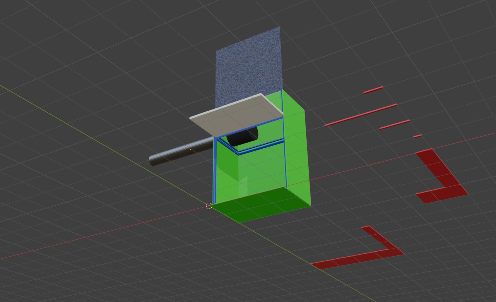
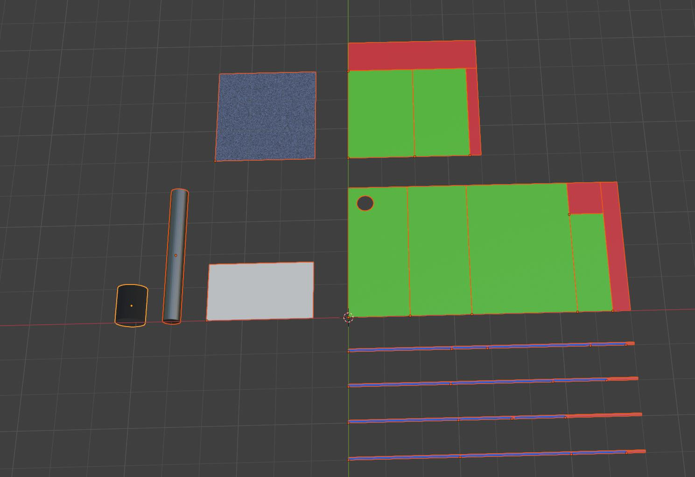

# YANINEKO #

AKA Fume Hood/Fume Extractor

## Inspiration ##

https://makezine.com/projects/diy-fume-hood/

## Tools Needed ##
- Measuring tape/stick
- Drill
    - (what size bit?)
    - Screw driver bit for assembly
- Saw for cutting boards and trim
    - Some cuts can be done in store, but there's a limit on how much they'll do
- Hammer for finishing nails

## BOM ##

- Plywood/OSB/etc: 48"x96" + 48"x48" - $40
    - https://www.homedepot.com/p/Plytanium-11-32-in-x-4-ft-x-8-ft-Rtd-Southern-Yellow-Pine-Plywood-Sheathing-112590/100003677
- Quarter-round: 4x96" - $20
    - https://www.homedepot.com/p/Woodgrain-Millwork-126-1-2-in-x-3-4-in-x-96-in-Primed-Finger-Jointed-Shoe-Moulding-1-Piece-8-Total-Linear-Feet-10004360/206178777
- 20x36x1 Air filter (or 2 20x18x1, etc.) merv 10-13 - $15-25
    - https://www.homedepot.com/p/HDX-20-in-x-36-in-x-1-in-Superior-Pleated-Air-Filter-FPR-9-MERV-11-HDX1P9-012036/315964772
- 6" 400+CFM Inline fan - $60 
    - https://www.homedepot.com/p/SKYSHALO-Inline-Duct-Fan-6-in-400-CFM-with-Variable-Speed-Controller-Quiet-AC-Motor-Ventilation-Exhaust-Fan-for-Booster-XLGDFJYCHSAC6J5DVV1-250208/334751996#overlay
- 36"x36" clear material
    - Polycarbonate 
        - $99 - https://www.homedepot.com/p/LEXAN-36-in-x-48-in-Polycarbonate-Sheet-1PC3648A/100289077
    - Glass 
        - $42 - https://www.acehardware.com/departments/building-supplies/windows-and-doors/glass-and-acrylic-sheets/11567
        - fragile, but best chemical resistance
- Screws ($11)
    - https://www.homedepot.com/p/Grip-Rite-8-x-2-in-Star-Drive-Dual-Flat-Head-Coarse-Thread-Construction-Screws-1-lb-Box-2GCS1/204959257
- Finishing nails for tacking quarterround in place - $5
    - https://www.homedepot.com/p/Everbilt-1-1-2-in-Zinc-Plated-Finishing-Nails-250-Pack-810932/205949048
- 6" dryer pipe
    - $20 - https://www.homedepot.com/p/Lambro-6-in-x-8-ft-Flexible-Aluminum-Semi-Rigid-Double-Lock-Air-Duct-306DL/342727714
- 6"-> 4" adapter
    - $15 - https://www.homedepot.com/p/Master-Flow-6-in-x-4-in-26-Gauge-Reducer-26R6X4/202191794
- Something to seal/protect the work surface
    - Silicon?
        - $100 - https://www.homedepot.com/p/Wudkey-36-in-x-24-in-Silicone-Mat-Heat-Resistant-Mats-for-Countertop-Multipurpose-Large-Silicone-Mats-Gray-PZ4Q87-0/341684517
- Storage/table
    - lock to keep out honest people
        - something like this to retrofit an existing cabinet
            - $17 - https://www.homedepot.com/p/First-Watch-Security-5-8-in-Chrome-Cabinet-and-Drawer-Utility-Cam-Lock-1358/202799777
            - $4 - https://www.amazon.com/Refrigerator-Kitchen-Freezer-Cabinets-Doors-No/dp/B0CW962XPG
    - $280 - https://www.mcmaster.com/4927T12/
    - $free? - something used from ebay or some marketplace
- Circular saw rental?
    - $16 for 4 hours - https://www.homedepot.com/p/rental/Makita-Circular-Saw-7-1-4-5377MG/316821620

- Optional upgrades
    - Outlet strip for power
        - $8 - https://www.homedepot.com/p/4-ft-6-Outlet-Power-Strip-with-45-Degree-Flat-Angle-Plug-White-YLPT-90/203353677
        - Or just find/get donation

    - Lighting
        - Some kind of light strips just below the filter?
        - very useful for soldering or other detailed work, but should be kept to a minimum during resin printing

total cost ~$400

Ideally you want the fan by the window, keeping as much of the system at negative pressure as possible, but as long as you seal everything well it should be fine to put it in the fume hood.
